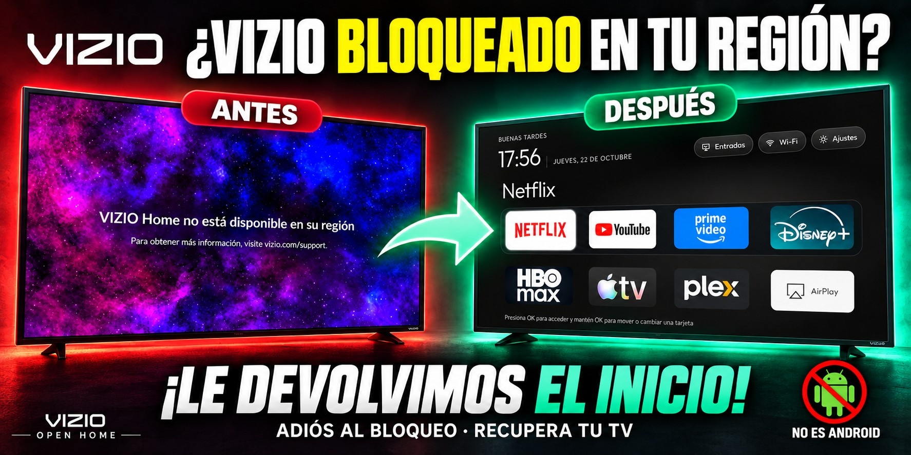
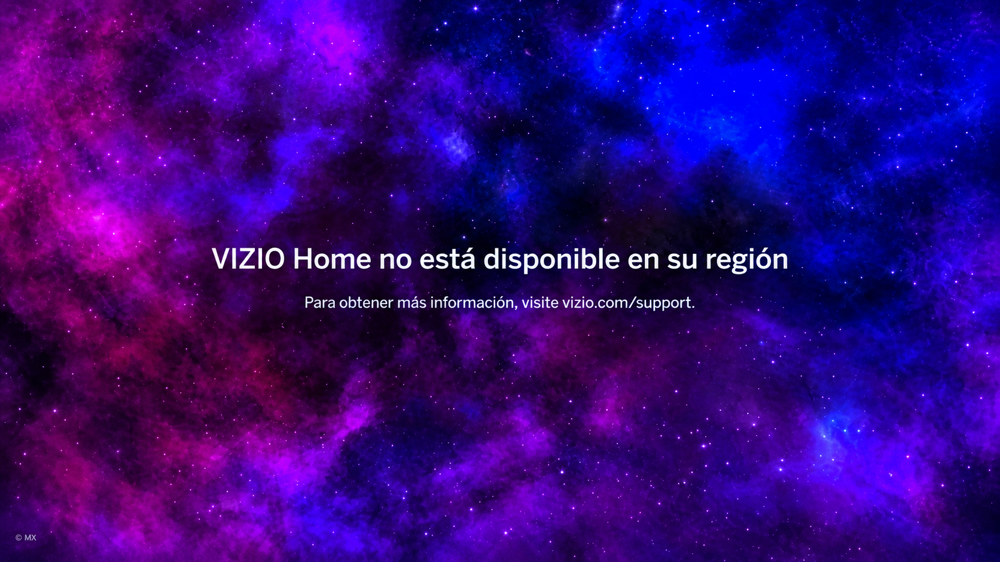
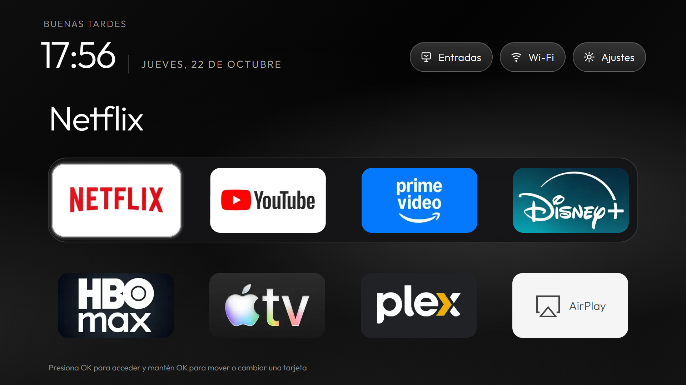
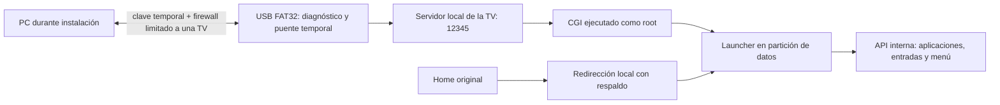

# Vizio Open Home: recupera el inicio de tu Vizio bloqueado por región

*Portada promocional compuesta con IA a partir de la reconstrucción del aviso regional y la vista previa del launcher. El bloqueo al que se refiere es el de VIZIO Home.*

**Recupera el inicio de una Vizio fuera de EE. UU. cuando VIZIO Home queda bloqueado por región.**

**Root confirmado. Home recuperado. Arranque autónomo, sin PC, USB ni Fire Stick.**

Un launcher local para una Vizio que mostraba **«VIZIO Home no está disponible en su región»** en México, aunque varias de sus aplicaciones seguían funcionando. Proyecto de **Jordan**, desarrollado y documentado con asistencia de **Codex, de OpenAI**.

La interfaz visual toma como referencia **CleanYourTV de Gathin**. La integración con esta Vizio, el launcher web, la biblioteca, persistencia, puente USB, instalación y recuperación se desarrollaron durante este proyecto. Consulta [los créditos completos](CREDITS.md).

## Para quienes usan una Vizio fuera de Estados Unidos

Este proyecto nació en México: la TV mostraba el aviso regional en su pantalla de inicio, pero Netflix, YouTube y otras apps podían abrirse por separado. Sustituimos ese inicio por un launcher local y enlazamos el botón Home y el arranque a él. **Así evitamos depender del inicio bloqueado para acceder a las apps que sí funcionan en nuestra región.**

Puede servir de referencia a otros propietarios de Vizio fuera de EE. UU. con el mismo problema. La compatibilidad demostrada se limita al modelo y firmware indicados abajo; necesitamos pruebas y aportaciones de otros equipos antes de ampliar esa lista.

### Sistema operativo: SmartCast sobre Linux, no Android

La M657-G0 de referencia usa la plataforma propietaria **Vizio SmartCast**, con componentes **SCPL** y una interfaz web. El diagnóstico de nuestra unidad identificó **Linux 3.10.0, ARMv7**. No es Android TV ni Google TV: no hay instalación de APK ni cambio a un launcher Android. Nuestro launcher está escrito en HTML, CSS y JavaScript y se ejecuta en el entorno web de la propia TV.

Vizio utiliza actualmente el nombre [VIZIO OS](https://www.vizio.com/en/vizio-os) para su plataforma. En esta documentación mantenemos SmartCast para describir el equipo probado. **VIZIO Home es el inicio; [WatchFree+](https://www.vizio.com/en/watchfreeplus) es un servicio de canales y contenido.** El aviso observado dice VIZIO Home: no afirmamos haber desbloqueado WatchFree+ ni haber cambiado la ubicación que detectan los servidores.

## Antes y después

**Antes: pantalla de bloqueo regional.** Reconstrucción parcial con IA a partir de la foto real del propietario: encuadre enderezado al área de pantalla y eliminación de reflejos y sombra. Se conserva el mensaje del aviso; el fondo reconstruido no es una captura digital original.

**Después: nuestro inicio local.** Captura a 1920 × 1080 del launcher público renderizado en un navegador de escritorio, sin conexión a la TV. Es una vista previa del diseño, no una captura extraída del framebuffer de la Vizio. La navegación, Home y arranque en el equipo real están documentados por separado en las pruebas.

## Qué conseguimos de verdad

En una **Vizio M657-G0, plataforma SX7B, firmware 7.0.120.1-1, grupo 271**:

- Ejecutar un diagnóstico desde USB con identidad **`uid=0(root) gid=0(root)`**.
- Abrir un menú propio, navegable con el control, y lanzar aplicaciones mediante la API interna de la TV.
- Recuperar **Home** y el menú al encender, primero desde USB y finalmente desde la memoria interna.
- Conservar **HDMI y volumen**, comprobados por el propietario después de apagar y encender sin USB.
- Crear un puente temporal para transferir archivos sin mover la memoria USB entre TV y PC cada vez.
- Mantener respaldos, comparar contenido de vuelta y retirar el servidor y la regla de firewall al terminar.

**No desbloquea los catálogos regionales de Netflix, ViX, Pluto u otros servicios.** Sustituye el inicio que no funciona en la región; cada aplicación conserva sus propias restricciones. No instala Android, no flashea firmware y no convierte cualquier Vizio en compatible.

## El launcher

Cuadrícula **4 × 3** con «Más apps» fijo en la última posición, biblioteca del catálogo SmartCast, cambio y reordenación de tarjetas, última app seleccionada y orden guardados localmente. Saludos según la hora, fuente Outfit, reloj, fondo negro con luces blancas suaves, Entradas, información Wi-Fi y acceso a Ajustes.

- **OK** abre una tarjeta.
- **Mantener OK** ofrece mover o cambiar la app.
- En modo mover, las **flechas** cambian su posición; **OK o Atrás** guardan.
- «Más apps» permite abrir una app o sustituir una tarjeta. No instala APK.
- La biblioteca contiene **344 entradas del catálogo capturado durante el desarrollo**; no son 344 apps verificadas en México.

## Compatibilidad y estado

| Parte | Evidencia |
| --- | --- |
| Root por CGI desde USB | Confirmado en el diagnóstico del dispositivo de referencia |
| Home sin USB | Confirmado por el propietario |
| Encendido sin USB | Confirmado por el propietario |
| HDMI y volumen | Confirmados después de la instalación interna |
| ViX, MUBI, Tubi | Catálogo o pantalla de acceso cargaron; reproducción completa no verificada |
| Pluto TV | Abrió, pero mostró error persistente: no se añadió |
| Paramount+ | No abrió correctamente: no se añadió |
| Actualización OTA / corte de energía prolongado | No se verificó que conserven el parche |
| Otros modelos / firmwares | Sin validación de este proyecto |

Los fallos de dos apps en una TV no se convierten en una prohibición global de la biblioteca pública. [Detalle de pruebas](data/reference-test-results.json).

## Instalar y volver atrás

1. Lee [instalación](docs/INSTALL.md) y [restauración](docs/RESTORE.md) **antes** de escribir en la TV.
2. Prepara el proyecto con Node.js 24: `npm ci --ignore-scripts`, `npm run build`, `npm test`.
3. Empareja la API de tu propia TV, prepara una USB FAT32 y confirma root con el diagnóstico de solo lectura.
4. Respalda el Home original y `sc-config.json` de **tu** TV. Nunca uses la configuración de otra unidad.
5. Prueba el launcher desde USB. Después sigue la migración en dos etapas y verifica el contenido leído de vuelta.
6. Retira la USB y prueba Home, encendido, apps, HDMI y volumen.

Las herramientas públicas de empaquetado se prueban con tests locales. **No se volvió a instalar la TV funcional para ensayar este paquete nuevo**: el método y las rutas se verificaron durante el desarrollo; el empaquetado público requiere su propia prueba controlada. No existe una garantía de desbrickeo ni de downgrade.

## Cómo funciona

La ruta usada finalmente fue `http://127.0.0.1:12345/scfs/codex-home/index.html`. En este dispositivo, `/tmp/scfs` estaba montado sobre almacenamiento persistente: **el prefijo `/tmp` no significaba que ese contenido se perdiera al apagar**. Se comprobó con el ciclo de encendido sin USB; no debe extrapolarse a otros equipos.

- [Historia completa y callejones sin salida](docs/DEVELOPMENT_LOG.md)
- [Root: alcance y procedencia](docs/ROOT.md)
- [Puente, firewall y límites de transferencia](docs/BRIDGE.md)
- [Arquitectura y preferencias](docs/ARCHITECTURE.md)
- [Privacidad antes de subir a GitHub](docs/PUBLISH.md)

## Créditos y licencias

Jordan: autor del proyecto, decisiones, diseño aplicado y pruebas físicas. Codex (OpenAI): asistencia en investigación, programación, diagnóstico, pruebas y documentación. **CleanYourTV / Gathin: referencia y adaptación del diseño visual**, bajo MIT; no se atribuye a CleanYourTV la solución de integración de esta Vizio.

La investigación USB previa de ELTON y el trabajo de Exploitee.rs se citan por separado: no afirmamos haber descubierto esas vulnerabilidades. Outfit conserva su licencia OFL y los logos pertenecen a sus marcas. [CREDITS.md](CREDITS.md) · [THIRD_PARTY_NOTICES.md](THIRD_PARTY_NOTICES.md) · [LICENSE](LICENSE).
